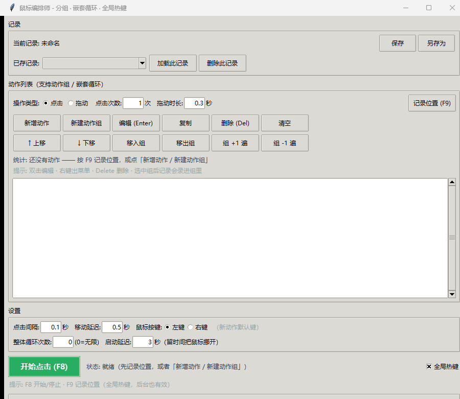

# 鼠标编排师 (Mouse Maestro)

一个支持**分组编排、嵌套循环、全局热键**的 Windows 鼠标自动化工具。  
你可以把一系列点击/拖动动作打包成「动作组」，给每个组设置独立的循环次数，组之间还能嵌套，真正做到「先执行 A 组 100 遍 → 再执行 B 组 5 遍 → 整体无限循环」这类复杂流程。



## 核心特性

- **动作组（Group）** —— 把多个动作打包成一个节点，像文件夹一样管理。
- **嵌套循环** —— 组内可以再套组，层级不限；每个组有自己的循环次数（0 = 无限）。
- **两种「次数」分离**
  - **点击次数**：同一个坐标连续点几下（连点）。
  - **循环遍数**：整个动作重复执行几遍。
  - 两者相乘 = 实际总点击数，列表里直接显示。
- **每个动作独立按键** —— 点击/拖动可以分别设为左键或右键。
- **全局热键 F8 / F9** —— 即使程序没有焦点、甚至最小化，也能随时开始/停止或记录位置。
- **单窗口编辑** —— 双击动作即可编辑：类型、坐标、次数、循环、时长一次改完，支持「取当前鼠标位置（3 秒倒计时）」。
- **统计行** —— 执行前就知道一轮要操作多少次、大约要花多久。
- **记录保存** —— 支持保存 / 另存为 / 加载 / 删除，设置项一并保留。

## 快速开始

### 1. 直接运行（推荐）

下载 `鼠标编排师.exe`，双击即用，无需安装 Python。  
（从右侧 [Releases](https://github.com/wodty/mouse-maestro/releases) 下载最新版。）

### 2. 从源码运行

```bash
# 1. 克隆仓库
git clone https://github.com/wodty/mouse-maestro.git
cd mouse-maestro

# 2. 创建虚拟环境并安装依赖
python -m venv .venv
.venv\Scripts\pip install -r requirements.txt

# 3. 运行
.venv\Scripts\python mouse_clicker_v2.py
```

> 提示：如果全局热键启动失败（pynput 需要管理员权限或某些安全软件拦截），程序会自动回退到「仅窗口内有效」模式，F8/F9 只在程序窗口有焦点时生效。

## 打包成 exe

```bash
.venv\Scripts\pip install pyinstaller
.venv\Scripts\pyinstaller --noconfirm --clean --onefile --windowed --name 鼠标编排师 mouse_clicker_v2.py
```

打包完成后，`dist/鼠标编排师.exe` 即为单文件可执行版本。

## 使用说明

### 编排一次「动作 1/2/3 走 100 遍 → 动作 4 循环 5 次 → 整体无限循环」

1. 点 **「新建动作组」** → 组名 `组A`、循环 **100** 遍 → 建完后该组自动被选中。
2. 把鼠标移到目标位置，按 **F9** 依次记录动作 1、2、3（它们会自动加进 `组A`）。
3. 在动作列表空白处点一下取消选中，再点 **「新建动作组」** → 组名 `组B`、循环 **5** 遍 → 记录动作 4。
4. 把 **「整体循环次数」** 设为 **0**（无限）。
5. 按 **F8** 开始。

结果：`(1→2→3) × 100 → (4) × 5` 无限循环。

### 快捷键

| 按键 | 作用 |
|------|------|
| **F8** | 开始 / 停止点击（全局有效） |
| **F9** | 记录当前鼠标位置（全局有效） |
| **Enter** | 编辑选中动作（列表内） |
| **Delete** | 删除选中动作 |
| **Ctrl + D** | 复制选中动作 |
| **Ctrl + ↑ / ↓** | 上移 / 下移 |


## 项目结构

```
.
├── mouse_clicker_v2.py      # 主源码
├── tests/                   # 测试集合
│   ├── test_engine.py       # 执行引擎（嵌套计数、无限循环、中断）
│   ├── test_edit_dialog.py  # 编辑对话框（字段写回、类型切换、取消）
│   ├── test_ui.py           # 界面冒烟（树操作、记录管理）
│   ├── test_layout.py       # 布局体检（无溢出）
│   ├── test_hotkey.py       # 全局热键状态机
│   └── test_button.py       # 左/右键独立配置
├── assets/
│   └── screenshot.png       # 界面截图
├── 鼠标编排师.exe           # 单文件发布版（Windows）
├── requirements.txt
├── CHANGELOG.md
├── LICENSE
└── README.md
```

## 版本历史

参见 [CHANGELOG.md](CHANGELOG.md)。

## License

MIT License © 2026 [wodty](https://github.com/wodty)
